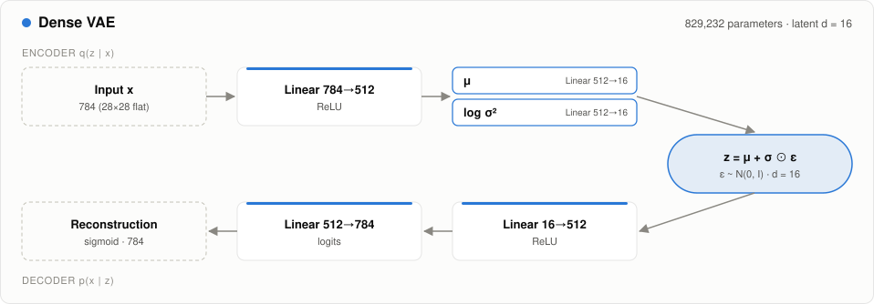
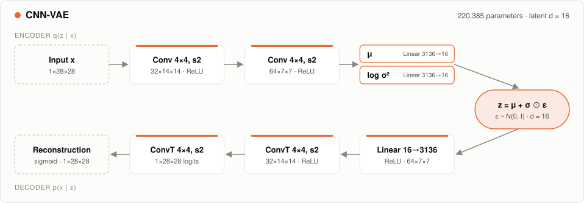
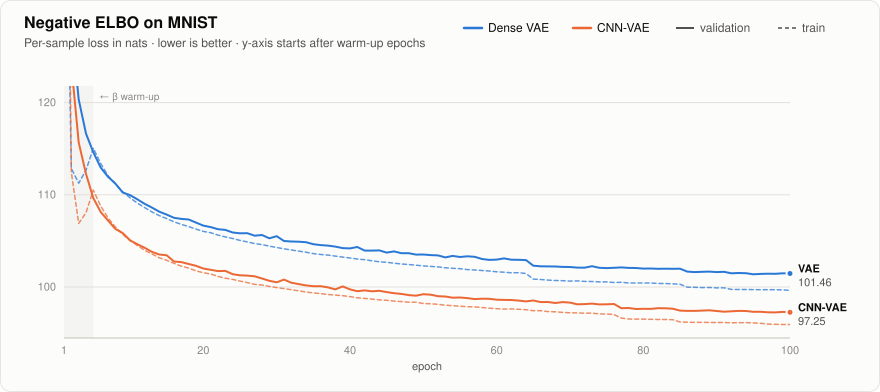
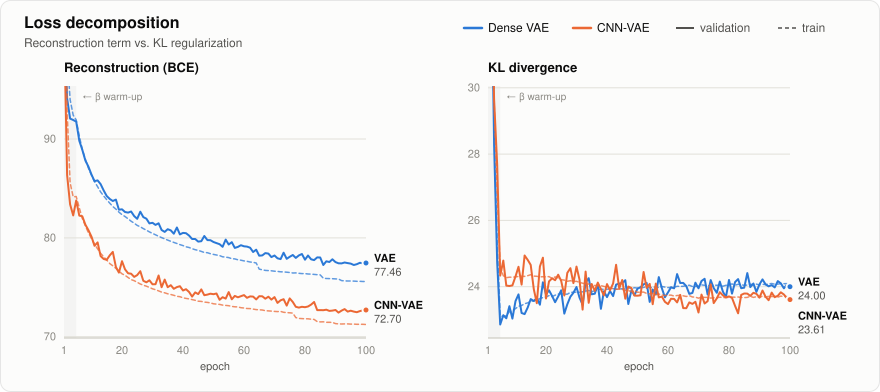
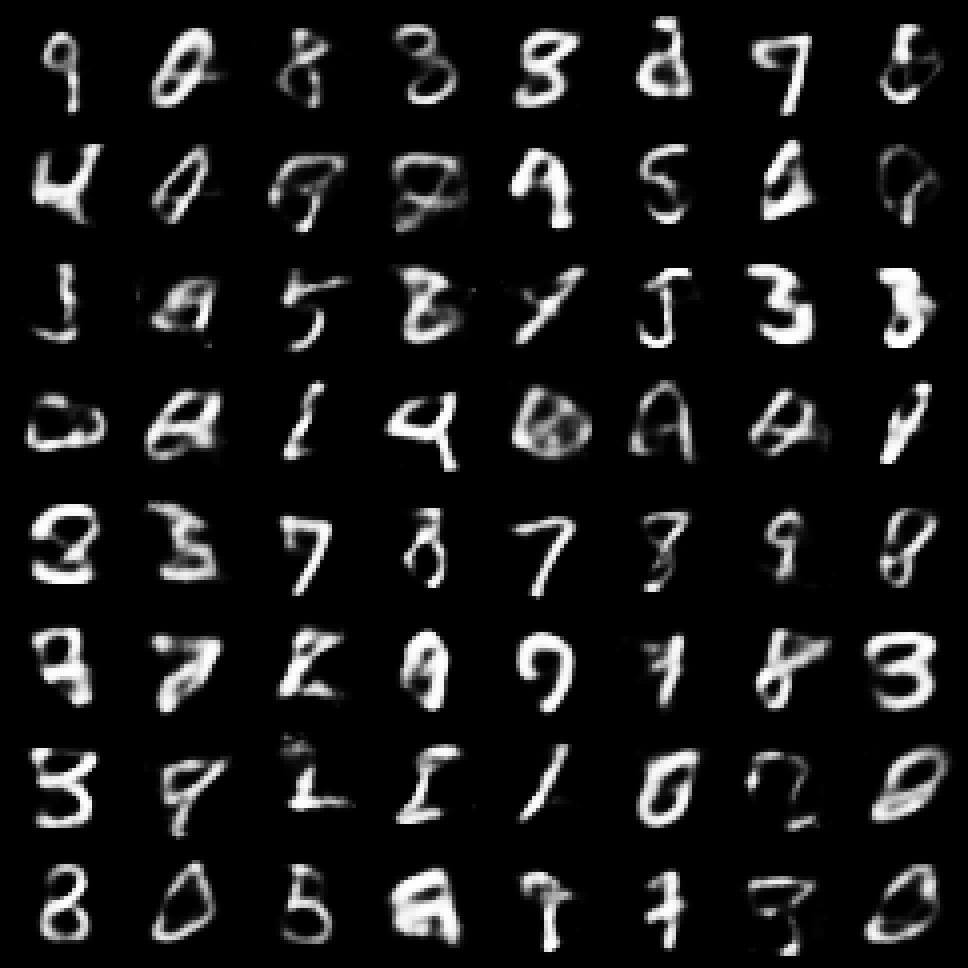
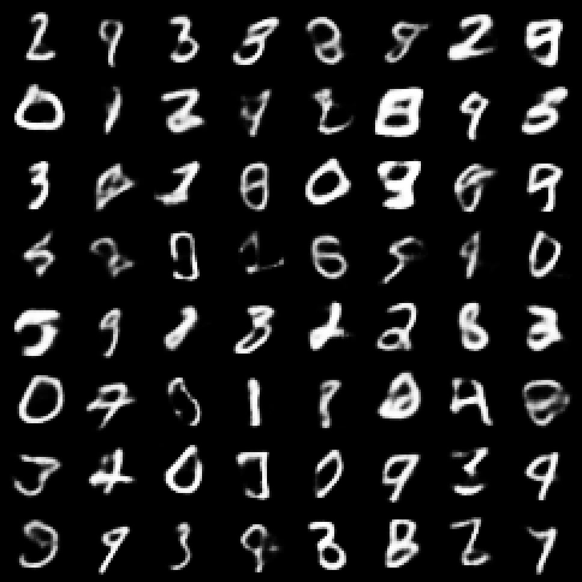

<div align="center">

# vae-comp

Dense and convolutional variational autoencoders on MNIST, implemented in Rust with [Burn](https://burn.dev).


</div>

This project compares two variational autoencoder architectures using a shared
training and evaluation pipeline:

- Dense VAE: a fully connected encoder and decoder operating on flattened
  784-pixel images.
- CNN-VAE: a convolutional encoder and transposed-convolution decoder operating
  internally on the spatial structure of 28 × 28 images.

Both models use a 16-dimensional diagonal-Gaussian latent space and a decoder
that produces one logit per pixel.

The runs share the data split, preprocessing, loss definition, optimizer
configuration, scheduling rules and seed settings. They do not have the same
parameter count or computational workload, and their learning-rate trajectories
can differ because scheduling depends on each model's validation loss.

## Results at a glance

The table reports test metrics for each model's checkpoint with the lowest
eligible validation loss. Test reconstruction loss is averaged over five
posterior samples per image; the Gaussian KL term is computed analytically.

All losses are summed over pixels or latent dimensions and averaged over images.
Natural logarithms are used, so the numerical units are nats per image.

| Model | Parameters | Best epoch | BCE + KL | Reconstruction BCE | KL | Train time / epoch¹ |
| :-- | --: | --: | --: | --: | --: | --: |
| Dense VAE | 829,232 | 95 | 100.75 | 76.83 | 23.92 | 0.52 s |
| CNN-VAE | 220,385 | 96 | 95.72 | 72.12 | 23.59 | 3.15 s |

¹ Mean training-loop wall-clock time over epochs 2–100 in the reported Metal
runs, measured on an Apple M4 (macOS 26.6). Validation is not included in this column. Epoch 1 is excluded to reduce
the influence of first-use initialization and compilation costs. This is not
GPU kernel time or a hardware-independent benchmark.

Metrics are rounded independently; the displayed BCE and KL values may not sum
exactly to the displayed total.

> [!NOTE]
> In these runs, the CNN-VAE achieved a 5.03-nat lower test objective with
> approximately 3.76× fewer parameters.
>
> The difference is driven mainly by reconstruction: its BCE is 4.71 nats lower,
> while its KL is 0.33 nats lower. Its measured training time per epoch is
> approximately 6.1× that of the dense model.
>
> These are single-seed results for two specific architectures, not a general
> ranking of dense and convolutional VAEs.

## What this experiment measures

The experiment evaluates three related but distinct properties:

- Reconstruction: how well the decoder reproduces an image when the latent code
  is sampled from its encoder posterior.
- Regularization: how far that posterior is from the standard-normal prior.
- Prior generation: what the decoder produces when given a latent code sampled
  directly from the prior.

The test loss measures the first two. The sample grids illustrate the third,
but do not provide an objective measure of sample quality, diversity or
coverage of all digit classes.

A lower reconstruction loss does not automatically imply better prior samples.

## Objective

### Latent-variable model

The prior is a standard normal distribution:

```math
p(z) = \mathcal{N}(0, I).
```

The encoder predicts a diagonal-Gaussian approximate posterior:

```math
q_\phi(z \mid x)
=
\mathcal{N}
\left(
\mu_\phi(x),
\operatorname{diag}\left(\sigma_\phi^2(x)\right)
\right).
```

For a valid observation likelihood, the negative ELBO consists of an expected
negative log-likelihood and a KL regularization term. This project uses the
following BCE-based training objective:

```math
\mathcal{L}_\beta(x)
=
\mathbb{E}_{q_\phi(z \mid x)}
\left[
\operatorname{BCEWithLogits}
\left(
a_\theta(z), x
\right)
\right]
+
\beta
D_{\mathrm{KL}}
\left(
q_\phi(z \mid x) \,\|\, \mathcal{N}(0,I)
\right),
```

where $a_\theta(z)$ denotes the decoder's pixel logits.

### Reconstruction loss

Pixels are divided by 255 and kept as grayscale values in $[0,1]$.
They are not binarized.

For a decoder logit $a_j$, the reconstruction term is:

```math
\operatorname{BCE}(a,x)
=
-\sum_{j=1}^{784}
\left[
x_j \log \operatorname{sigmoid}(a_j)
+
(1-x_j)\log \operatorname{sigmoid}(-a_j)
\right].
```

The implementation uses `log_sigmoid` directly for numerical stability.
It sums over the 784 pixels and averages over images in the batch.

> [!IMPORTANT]
> This is the commonly used Bernoulli-style BCE objective applied to continuous
> grayscale targets.
>
> A Bernoulli distribution has support on binary observations, not arbitrary
> values in $[0,1]$. Consequently, the reported BCE + KL should not be treated
> as an exact negative ELBO or negative log-likelihood for a normalized
> continuous-image likelihood.
>
> The values are useful for comparisons under this shared protocol, but should
> not be compared directly with published likelihood results on binarized MNIST
> or with different observation models.

For binary targets and $\beta=1$, the same loss expression corresponds to a
Monte Carlo estimate of the negative ELBO under a Bernoulli decoder.

### KL regularization

The encoder outputs `mu` and `logvar`, with:

```math
\mathrm{logvar}_j = \log \sigma_j^2.
```

The KL divergence has the closed form:

```math
D_{\mathrm{KL}}
=
\frac{1}{2}
\sum_j
\left[
\mu_j^2
+
\exp(\mathrm{logvar}_j)
-
\mathrm{logvar}_j
-
1
\right].
```

It is summed over latent dimensions and averaged over images.

A similar average KL does not imply that two models encode the same amount of
information. The expected KL decomposes as:

```math
\mathbb{E}_{p_{\mathrm{data}}(x)}
\left[
D_{\mathrm{KL}}
\left(
q_\phi(z \mid x) \,\|\, p(z)
\right)
\right]
=
I_q(X;Z)
+
D_{\mathrm{KL}}
\left(
q_\phi(z) \,\|\, p(z)
\right),
```

where $q_\phi(z)$ is the aggregated posterior.

The KL therefore includes both input–latent mutual information and mismatch
between the aggregated posterior and the prior.

### Reparameterization

Latent codes are sampled using:

```math
z
=
\mu
+
\exp\left(\frac{1}{2}\mathrm{logvar}\right)
\odot \varepsilon,
\qquad
\varepsilon \sim \mathcal{N}(0,I).
```

The random noise is independent of the encoder parameters. The transformation
from `mu`, `logvar` and noise to `z` remains differentiable.

Computing the standard deviation through an exponential gives positive values
in exact arithmetic; floating-point overflow or underflow remains possible.

## Architectures

### Dense VAE

<picture>
  <source media="(prefers-color-scheme: dark)" srcset="docs/figures/arch-vae-dark.svg">
  
</picture>

Implemented in `src/models/vae.rs`.

```text
Encoder:
[N, 784]
  → Linear 784 → 512 + ReLU
  → separate Linear heads 512 → 16 for mu and logvar

Decoder:
[N, 16]
  → Linear 16 → 512 + ReLU
  → Linear 512 → 784 logits
```

There is one hidden layer in the encoder and one in the decoder. The Gaussian
heads and final output layer have no activation in the training path.

Dense layers are constructed through the project's Xavier-uniform helper in
`src/models/utils.rs`. Initialization gains are configured at each call site.

### CNN-VAE

<picture>
  <source media="(prefers-color-scheme: dark)" srcset="docs/figures/arch-cnn-dark.svg">
  
</picture>

Implemented in `src/models/cnnvae.rs`.

```text
Encoder:
[N, 784]
  → reshape [N, 1, 28, 28]
  → Conv2d 1 → 32, kernel 4, stride 2, padding 1 + ReLU
  → Conv2d 32 → 64, kernel 4, stride 2, padding 1 + ReLU
  → flatten [N, 3136]
  → separate Linear heads 3136 → 16 for mu and logvar

Decoder:
[N, 16]
  → Linear 16 → 3136 + ReLU
  → reshape [N, 64, 7, 7]
  → ConvTranspose2d 64 → 32, kernel 4, stride 2, padding 1 + ReLU
  → ConvTranspose2d 32 → 1, kernel 4, stride 2, padding 1
  → flatten [N, 784] logits
```

Spatial resolution changes as $28 \rightarrow 14 \rightarrow 7$ in the encoder
and $7 \rightarrow 14 \rightarrow 28$ in the decoder.

The model is not fully convolutional: it uses three linear projections around
the 3,136-dimensional feature representation.

Input size, channel widths and latent size are passed to `CNNVAE::new` from
`src/main.rs`, mirroring `VAE::new`. Initialization is explicit:

| Layers | Initializer | Gain |
| :-- | :-- | --: |
| Linear heads and decoder projection | Xavier uniform (shared `linear` helper) | √2 |
| `Conv2d` encoder layers | Xavier uniform | √2 |
| First `ConvTranspose2d` | Kaiming uniform | √2 |
| Output `ConvTranspose2d` | Kaiming uniform | 1 |

Burn only provides `fan_in` to transposed convolutions, so Xavier cannot be used
there. Initialization is therefore similar, but not identical, across
architectures.

### Parameter counts

Counts include trainable weights and biases for the configurations above.

| Component | Dense VAE | CNN-VAE |
| :-- | --: | --: |
| Encoder feature layers | 401,920 | 33,376 |
| Gaussian heads | 16,416 | 100,384 |
| Decoder | 410,896 | 86,625 |
| Total | 829,232 | 220,385 |

In the CNN-VAE, the two Gaussian heads and initial decoder linear projection
contain 153,696 parameters: approximately 69.7% of the total.

Fewer parameters do not necessarily mean less arithmetic or faster execution.
Convolutional weights are reused across spatial positions.

## Training protocol

Configuration is defined in `src/main.rs`; the shared implementation is in
`src/training.rs`.

| Setting | Value |
| :-- | :-- |
| Training data | 54,000 images |
| Validation data | 6,000 images, held out from the original MNIST training set |
| Test data | 10,000 images |
| Split seed | 42 |
| Preprocessing | Grayscale pixel values divided by 255; no binarization |
| Latent dimensions | 16 |
| Optimizer | Adam |
| Batch size | 256 |
| Data-loader workers | 2 |
| Initial learning rate | 1e-3 |
| Minimum learning rate | 1e-5 |
| Maximum epochs | 100 |
| LR reduction | Multiply by 0.5 after 5 epochs without a significant validation improvement |
| Improvement threshold | 0.05 nats per image |
| KL warm-up | Training beta is 0.2, 0.4, 0.6, 0.8 and 1.0 in epochs 1–5; then remains at 1.0 |
| Early stopping | 15 epochs without a significant validation improvement |
| Checkpoint selection | Lowest validation BCE + KL, evaluated with beta = 1, starting at epoch 5 |
| Validation sampling | 3 posterior samples per image |
| Final test sampling | 5 posterior samples per image |

The KL warm-up is intended to ease the introduction of regularization. It does
not guarantee prevention of posterior collapse, and its benefit is not isolated
by this comparison.

Validation always uses beta = 1. Training totals during warm-up therefore use a
different weighting and should not be compared directly with validation totals.

Checkpoint selection and patience use different rules:

- Any strictly lower eligible validation loss updates the best checkpoint.
- A decrease greater than `min_delta` relative to the patience reference resets
  the scheduler and early-stopping counters.
- Smaller improvements can update the checkpoint without resetting those
  counters.

Both reported runs completed 100 epochs; early stopping did not trigger.

## Training curves

<picture>
  <source media="(prefers-color-scheme: dark)" srcset="docs/figures/loss-total-dark.svg">
  
</picture>

The plotted runs show a lower objective for the CNN-VAE throughout training;
final validation totals are 101.46 (dense) and 96.31 (CNN). Beta warm-up covers
epochs 1–5, and the learning rate was halved at epochs 65, 86 and 92 (dense) and
77, 84 and 90 (CNN), which explains the visible steps late in training.

Training metrics average losses computed while the model parameters are being
updated. Validation metrics are computed afterward using a fixed evaluation
snapshot and multiple posterior samples. They are not identical measurements.

A small train/validation gap is encouraging, but does not prove the absence of
overfitting or establish that the models have converged.

The selected checkpoints are epochs 95 and 96, respectively. The table reports
test results for those checkpoints, not necessarily for the final epoch.

<picture>
  <source media="(prefers-color-scheme: dark)" srcset="docs/figures/loss-components-dark.svg">
  
</picture>

The test results show that the CNN-VAE's lower total objective is primarily
associated with lower reconstruction BCE, while the average KL terms are close.

This is consistent with a benefit from spatial structure and weight sharing,
but the experiment does not isolate those factors from other architectural and
initialization differences.

## Generated images

The following grids use each model's best validation checkpoint and 64 latent
codes sampled from the standard-normal prior:

```math
z \sim \mathcal{N}(0,I).
```

| Dense VAE | CNN-VAE |
| :--: | :--: |
|  |  |

The saved grayscale intensities are `sigmoid(decoder_logits)`: the decoder's
pixel-probability outputs. Pixels are not additionally sampled from Bernoulli
distributions.

These grids support qualitative inspection of strokes and digit shapes. They
do not establish class balance, novelty, distributional coverage or an objective
sample-quality advantage.

For a more informative comparison, also inspect held-out originals alongside:

- Reconstructions from `decode(mu)`, without posterior sampling.
- Reconstructions using sampled latent codes from the encoder posterior.

## Reproduce

### Requirements

- A Rust toolchain supporting edition 2024.
- The Burn version and features specified in `Cargo.toml`.
- A Mac supported by the configured Metal backend.
- Network access on the first run to obtain MNIST.
- Node.js to regenerate the SVG figures.
- Python 3 to serve the optional chart viewer.

The training entry point selects Metal explicitly. Other platforms require
changing the device selection and enabling the corresponding Burn backend.

### Run training

From the repository root:

```bash
cargo run --release -- vae
cargo run --release -- cnn
```

Running without an architecture argument defaults to the dense VAE:

```bash
cargo run --release
```

Show CLI help:

```bash
cargo run --release -- --help
```

### Outputs

Each run writes to `artifacts/<model>/`, where `<model>` is `vae` or `cnn`.

| File | Content |
| :-- | :-- |
| `history.csv` | Per-epoch learning rate, beta, train/validation losses and timings |
| `test.csv` | Selected epoch and final test BCE + KL, BCE and KL |
| `best.bpk` | Weights of the checkpoint selected by validation |
| `last.bpk` | Weights at the end of training |
| `generated-grid.png` | Grid of 64 prior-decoded images |
| `generated-single.png` | Enlarged first image from the grid |

> [!WARNING]
> Re-running an architecture overwrites the files in its output directory.
> Copy or rename that directory before starting a run you want to preserve.
>
> The weight files do not contain Adam state or the complete training state.
> The current CLI starts a new training run; it does not resume training.
> Checkpoints from different architectures or layer dimensions are not
> interchangeable.

On macOS, open the generated grids with:

```bash
open artifacts/vae/generated-grid.png
open artifacts/cnn/generated-grid.png
```

## Timing and reproducibility

`train_seconds` measures the training loop, metric extraction and device
synchronization. `epoch_seconds` also includes validation and checkpoint
selection work performed within the measured epoch.

The timing table above summarizes `train_seconds`, not full epoch duration.

For reproducible performance comparisons, record:

- Mac model and chip.
- Operating-system version.
- Rust and Burn versions, including the dependency lockfile.
- Precision, batch size and worker count.
- Warm-up policy and measured epochs.
- Whether loading, validation and metric extraction are included.
- Background workload and power conditions.

The figures reported here do not establish an advantage over PyTorch: no
equivalent PyTorch benchmark is included.

Using the same seed settings makes the split and random operations repeatable
to the extent supported by the execution environment. It does not guarantee
bitwise-identical runs, identical initial weights across architectures or equal
random-number consumption.

For stronger model-quality conclusions, repeat each architecture with multiple
seeds and report mean and variability rather than only a single run.

## Charts

The visualization tooling is in [`docs/charts/`](docs/charts).

| File | Role |
| :-- | :-- |
| `charts.js` | SVG renderers for loss curves and architecture diagrams |
| `index.html`, `style.css`, `app.js` | Interactive chart viewer |
| `export.js` | Exports light and dark SVGs to `docs/figures/` |

Regenerate the README figures after updating the training results:

```bash
node docs/charts/export.js
```

Serve the viewer from the repository root:

```bash
python3 -m http.server
```

Then open:

```bash
open http://localhost:8000/docs/charts/
```

The SVGs embedded in this README are exported snapshots. Regenerate them after
a new experiment so that figures, tables and CSV results remain consistent.

## Project structure

```text
.
├── Cargo.toml
├── Cargo.lock
├── src/
│   ├── main.rs          # CLI, configuration and model selection
│   ├── training.rs      # Shared loss, training and evaluation
│   ├── io.rs            # PNG export and io module declaration
│   ├── io/
│   │   └── mnist.rs     # MNIST preprocessing, split and loaders
│   ├── models.rs        # Shared VariationalModel interface
│   └── models/
│       ├── vae.rs       # Dense VAE
│       ├── cnnvae.rs    # Convolutional VAE
│       └── utils.rs     # Xavier-initialized linear layer helper
├── artifacts/
│   ├── vae/             # Dense VAE results
│   └── cnn/             # CNN-VAE results
└── docs/
    ├── charts/          # Chart template and SVG exporter
    └── figures/         # SVGs embedded in this README
```

## Limitations

- Results come from one seed per architecture.
- Timings come from a single machine (Apple M4) and are not a portable benchmark.
- Architectures differ in parameter count, operations and initialization.
- BCE is applied to continuous grayscale targets rather than binary observations.
- KL is not a direct measurement of latent mutual information or disentanglement.
- Sample grids are qualitative, not distribution-level evaluations.
- Validation uses a finite Monte Carlo estimate and therefore has sampling noise.

This repository is a controlled implementation comparison under a shared
protocol, not a claim that either architecture is universally superior.
